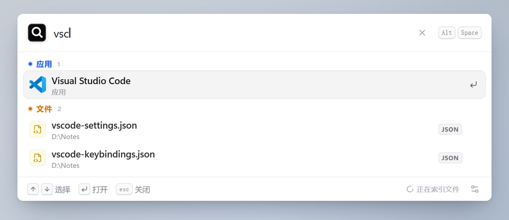
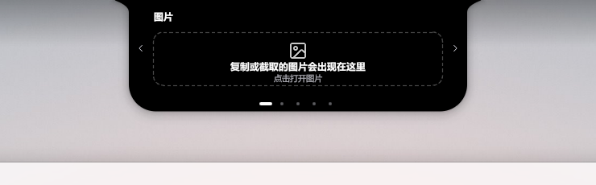
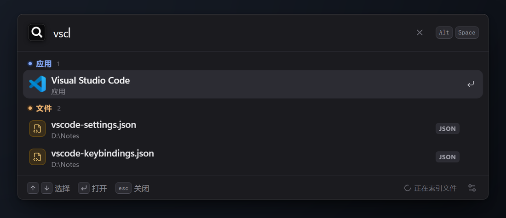

<div align="center">

# NEXORA

**两个独立的 Windows 桌面产品：快速启动器与桌面信息岛屿。**

搜索应用、文件和命令，或把音乐、消息、邮件和系统状态收进屏幕边缘。

</div>

<table>
  <tr>
    <td width="55%" align="center">
      <br>
      <sub><b>NEXORA</b> · 应用、文件与命令启动器</sub>
    </td>
    <td width="45%" align="center">
      <br>
      <sub><b>NEXORA ISLE · 岛屿</b> · 桌面信息岛屿</sub>
    </td>
  </tr>
</table>

## 产品

| 产品 | 定位 | 主要能力 | 目录 |
| --- | --- | --- | --- |
| **NEXORA** | 键盘优先的 Windows 启动器 | 应用/文件/命令搜索、自定义命令、文件索引、插件、剪贴板历史 | [`apps/nexora-launcher`](apps/nexora-launcher) |
| **NEXORA ISLE · 岛屿** | 屏幕边缘的桌面信息岛屿 | 媒体与歌词、微信/QQ/系统通知、邮件验证码、图片剪贴板、系统监控 | [`apps/nexora-isle`](apps/nexora-isle) |

两个产品拥有独立的运行时、数据目录、测试和发布包。安装其中一个不要求安装另一个。

## NEXORA

NEXORA 通过全局快捷键唤出，集中搜索应用、文件和内置命令。界面支持浅色/深色主题、紧凑和展开模式、命令作用域、拼音和首字母匹配。

<p align="center">
  
</p>

亮点：

- `Alt + Space` 快速唤出，支持键盘完整操作。
- 统一枚举开始菜单、AppsFolder、绿色应用和文件索引。
- 自定义命令支持网页、文件、程序和指定浏览器。
- 插件通过独立进程和 JSON-RPC 提供搜索结果。
- 剪贴板文本使用当前 Windows 用户的 DPAPI 加密保存。

## NEXORA ISLE · 岛屿

岛屿默认以鼠标点击展开，可切换为悬停展开；展开后提供音乐、视频、系统监控、文件口袋、图片、剪贴板和邮箱页面。

<p align="center">
  
</p>

亮点：

- 点击或悬停展开，移出后立即收起。
- 支持刘海、胶囊以及顶部/左右边缘停靠。
- 可视化布局编辑器支持常驻组件和功能页面拖拽排序。
- 微信、QQ 和 Windows 系统通知独立控制，默认开启。
- 邮箱账号保存在本机，凭据进入 Windows 凭据管理器，启动后自动重连。
- 图片剪贴板仅保存在内存中，支持独立查看器和右键另存为 PNG。

## 技术栈

| 层 | NEXORA | NEXORA ISLE |
| --- | --- | --- |
| 桌面外壳 | Tauri 2 | Rust + eframe/egui |
| 界面 | React 19 + TypeScript + Vite | 自绘 egui 面板 |
| Windows 集成 | Win32 + WebView2 | Win32、DWM、SMTC、Windows Notifications |
| 数据 | localStorage + DPAPI 文件 | 本地配置文件 + Windows Credential Manager |

## 快速开始

环境要求：

- Windows 10/11 x64
- Node.js 20+ 与 pnpm
- Rust stable MSVC
- Visual Studio C++ Build Tools 与 Windows SDK

```powershell
pnpm install
pnpm dev:launcher
pnpm dev:isle
```

生成可直接运行的调试版本：

```powershell
pnpm debug:launcher
pnpm debug:isle
pnpm debug:all
```

构建产物：

```text
apps/nexora-launcher/src-tauri/target/debug/nexora.exe
apps/nexora-isle/target/debug/nexora-isle.exe
```

## 测试与发布

```powershell
pnpm check:workspace
pnpm test:workspace
pnpm test:launcher
pnpm test:isle
pnpm test:all
```

打包全部产品：

```powershell
pnpm package:all
```

安装包和便携 ZIP 输出到根目录 `release/`：

```text
NEXORA_LAUNCHER_<版本>_x64_setup.exe
NEXORA_LAUNCHER_<版本>_portable.zip
NEXORA_ISLE_<版本>_x64_setup.exe
NEXORA_ISLE_<版本>_portable.zip
```

## 项目结构

```text
nexora/
├─ apps/
│  ├─ nexora-launcher/     # NEXORA 启动器
│  └─ nexora-isle/         # NEXORA ISLE · 岛屿
├─ docs/
│  ├─ architecture/        # 跨产品架构
│  └─ images/              # GitHub README 展示图
├─ scripts/                # 工作区编排、清理与检查
├─ products.psd1           # 产品清单
├─ package.json
└─ pnpm-workspace.yaml
```

产品工作区约束见 [`docs/architecture/product-workspace.md`](docs/architecture/product-workspace.md)。

## 隐私

NEXORA 和岛屿均在本机完成搜索、状态读取和配置保存。网络功能只在歌词查询、邮箱收取、插件执行和用户主动检查更新时使用；邮箱凭据由 Windows 凭据管理器保护。

## 许可

项目采用 [MIT License](LICENSE)。第三方字体、图标和依赖的许可说明保存在各产品目录及发布包中。
