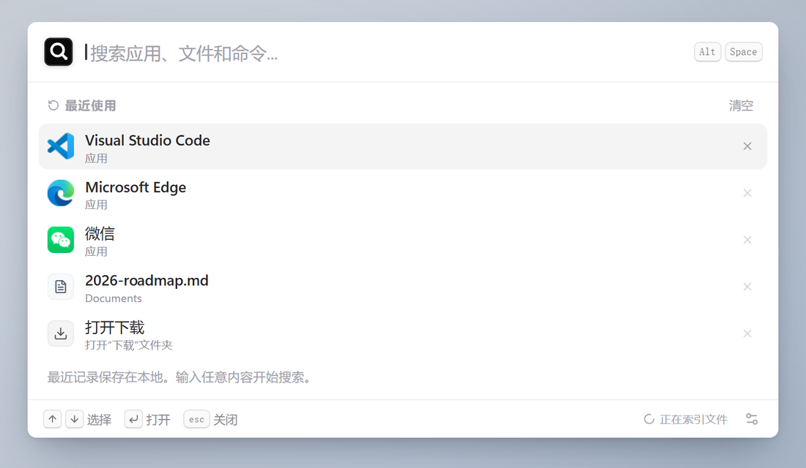
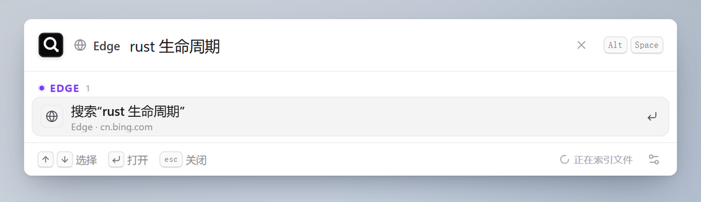
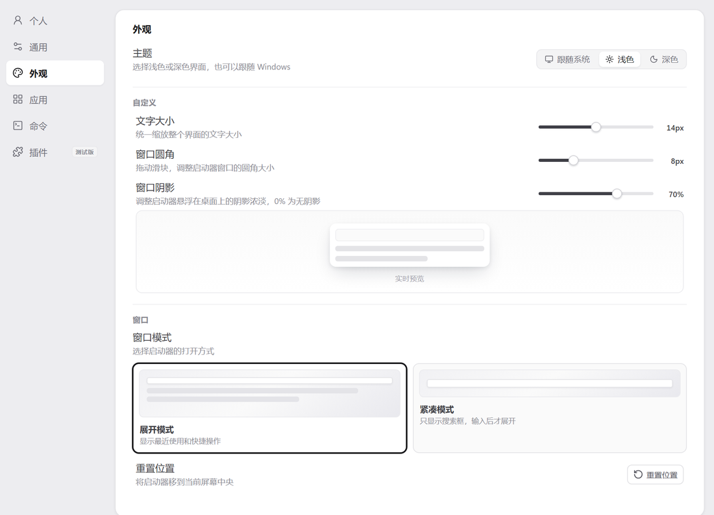
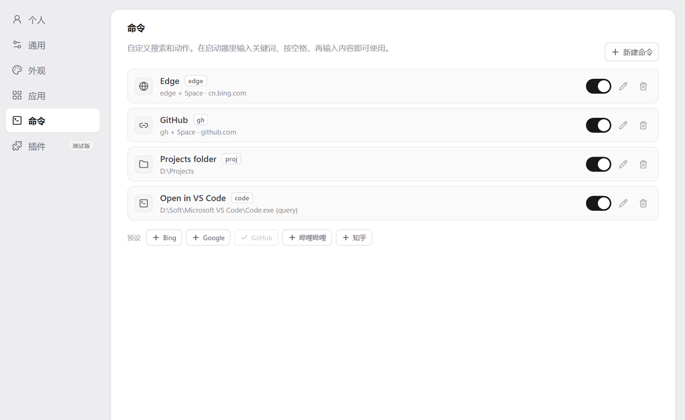
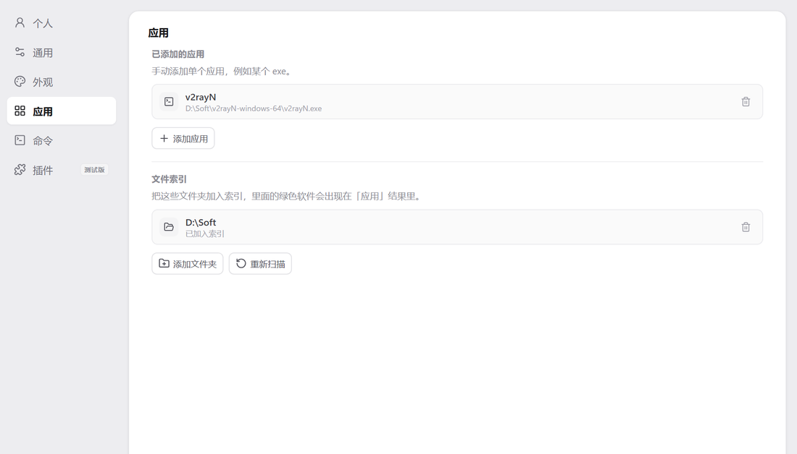
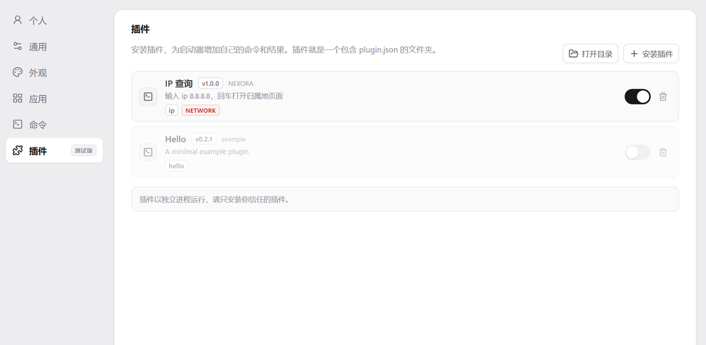

# NEXORA

**One Hub. Infinite Possibilities.** 一个 Windows 优先的轻量启动器：`Alt + Space` 唤出，搜索应用、文件与内置命令，结果分组展示、键盘全程可操作。无边框透明窗口、白色卡片、克制的圆角与动效；品牌图形是一枚自绘标记（墨色圆角方块 + 暖白圆环与启动点），既像搜索镜头，也像一切入口汇聚的那一点。


## 界面预览

启动器搜索应用、文件与命令，结果按类别分组；命令模式可以用「关键词 + 空格」把输入变成一个作用域标签；设置窗口覆盖外观、命令、应用、插件与配置备份。

> 截图取自 v0.2.2 开发版，实际界面以当前构建为准。

<table>
  <tr>
    <td width="50%" align="center">
      <br>
      <sub>启动器 · 最近使用与快捷操作</sub>
    </td>
    <td width="50%" align="center">
      <br>
      <sub>命令模式 · <code>Edge</code> + 空格 + 搜索内容</sub>
    </td>
  </tr>
  <tr>
    <td align="center">
      <br>
      <sub>设置 · 外观（主题 / 字号 / 圆角 / 阴影）</sub>
    </td>
    <td align="center">
      <br>
      <sub>设置 · 自定义命令与预设</sub>
    </td>
  </tr>
  <tr>
    <td align="center">
      <br>
      <sub>设置 · 应用与文件索引</sub>
    </td>
    <td align="center">
      <br>
      <sub>设置 · 插件（Beta）</sub>
    </td>
  </tr>
  <tr>
    <td colspan="2" align="center">
      <br>
      <sub>深色主题</sub>
    </td>
  </tr>
</table>

## 功能

**启动与窗口**
- 全局快捷键 `Alt + Space`（默认），注册失败时回退到 `Ctrl + Shift + Alt + Q`，设置页会提示冲突
- 无边框、透明、始终置顶；点击窗口外自动隐藏，拖拽期间防误关闭
- 重新唤出时会在“WebView2 接管键盘”之前缓冲按键，快速输入不会丢字、不会发出系统提示音
- 窗口模式：**展开模式**（最近使用 / 快捷操作）与**紧凑模式**（只有搜索框）
- 托盘图标 + 菜单（打开 / 设置 / 退出），单实例运行

**搜索**
- 已安装应用：同时枚举 Windows **AppsFolder**（UWP / MSIX / 经典应用）与开始菜单 `.lnk`
- 本机文件：桌面 / 文档 / 下载 / 图片，最多 20,000 条，内存索引
- 磁盘：输入 `D` / `D:` / `D://` / `D盘` 直接打开对应磁盘根目录，支持固定 / 可移动 / 网络 / 内存盘
- 内置命令：打开下载、桌面、文档、此电脑、回收站，刷新索引，打开设置，退出
- 模糊匹配：大小写不敏感、单词首字母（`vsc` → Visual Studio Code）、有序子序列、中文拼音（`wx` → 微信）
- 真实 Windows 图标：通过 Shell 提取并裁剪空白边距

**外观与配置**
- 主题：跟随系统 / 浅色 / 深色（原生标题栏同步换色）
- 外观：全局文字大小 11–17px、启动器圆角 0–28px、窗口阴影 0–100%（默认 100%）、界面字体（系统 / Inter / Geist）
- 自定义命令：关键词 + 空格触发，支持网页搜索 / 打开网址 / 打开文件或文件夹 / 运行程序，每条命令可指定浏览器
- 文件索引：配置若干文件夹，里面的绿色软件会合并进「应用」搜索结果
- 插件（Beta）：安装带 `plugin.json` 的插件文件夹，关键词触发、JSON-RPC 搜索、独立进程运行，可启停/卸载；协议见[插件开发指南](docs/plugin-development.md)，示例见 [`examples/plugins/ip`](examples/plugins/ip)
- 配置备份：一键导出 / 导入设置 JSON（含自定义命令；插件与文件索引需在新机器重新配置）

**键盘**

- `↑` `↓` 选择，`Enter` 打开，`Esc` 清空 / 关闭，`Ctrl + K` 聚焦搜索，`Ctrl + ,` 打开设置

## 名字与品牌

NEXORA 取自 *Nexus*（枢纽、连接点）与 *Aura / Orbit*（环绕、延伸），含义是「连接一切的数字中心」，标语是 **Everything starts here.**。

品牌图形是一枚自绘标记：墨色圆角方块代表入口，暖白圆环与中心启动点代表汇聚与出发；整体既像一枚搜索镜头，也像万物的一个起始点。

## 系统要求

| | 要求 |
| --- | --- |
| 系统 | Windows 10 1809+ / Windows 11 |
| 运行时 | WebView2 Runtime（Win11 自带；Win10 若缺失，安装包会联网安装） |
| 开发 | Node.js 20+、pnpm 9+、Rust stable（MSVC）、Visual Studio C++ Build Tools + Windows SDK |

## 快速开始

```bash
pnpm install          # 安装前端依赖（首次会同时拉取 Tauri CLI）
pnpm tauri dev        # 开发模式：Vite + Rust 热重载，自动打开启动器
```

开发模式下启动器窗口会立即出现；修改前端代码热更新，修改 Rust 代码会自动重编译并重启。

## 构建与打包

### 1. 只构建可执行文件

```bash
pnpm tauri build --no-bundle
```

产物：`src-tauri/target/release/nexora.exe`（已内嵌前端资源，可直接运行）。

### 2. 构建正式安装包（推荐分发）

```bash
pnpm tauri build
```

产物：

| 文件 | 说明 |
| --- | --- |
| `src-tauri/target/release/nexora.exe` | 主程序 |
| `src-tauri/target/release/bundle/nsis/NEXORA_<版本>_x64-setup.exe` | NSIS 安装包（按用户安装到 `%LOCALAPPDATA%\NEXORA`，自带卸载器） |

首次打包会自动下载 NSIS 工具链（仅一次，需要网络）。

### 3. 生成便携包

```powershell
Compress-Archive -Path src-tauri/target/release/nexora.exe `
  -DestinationPath release/NEXORA_<版本>_portable.zip -Force
```

### 4. 发布清单

仓库里的 `release/` 目录存放可直接分发的两份产物（已加入 `.gitignore`，只作为本地暂存）：

```text
release/
├─ NEXORA_0.2.2_x64-setup.exe    # 双击安装
└─ NEXORA_0.2.2_portable.zip     # 解压后直接运行 nexora.exe
```

发给别人时需要提醒两点：

1. 安装包没有代码签名，Windows 可能提示“已保护你的电脑”，点「更多信息 → 仍要运行」；
2. 首次启动会在屏幕中间弹出启动器，之后用 `Alt + Space` 或托盘图标唤出。

### 版本号

升级版本时同步修改三个文件（保持一致）：

- `package.json` → `version`
- `src-tauri/Cargo.toml` → `[package] version`
- `src-tauri/tauri.conf.json` → `version`

安装包文件名与“应用和功能”里的版本都取自 `tauri.conf.json`。发版后请在 [CHANGELOG.md](CHANGELOG.md) 追加记录。

> 构建前请先退出正在运行的 NEXORA（托盘 → 退出）。Windows 会锁定 `target/release/nexora.exe`，占用时构建会报 `failed to remove file`。

## 使用说明

| 操作 | 说明 |
| --- | --- |
| `Alt + Space` | 打开 / 隐藏启动器 |
| `Ctrl + ,` | 打开设置窗口 |
| `↑` `↓` `Enter` | 选择与打开结果 |
| `Esc` | 清空输入；再按一次关闭 |
| 按住搜索栏图标拖动 | 移动窗口（位置会被记住） |

- 配置保存在 WebView2 的 `localStorage`（`nexora.settings.v1`）与最近记录（`nexora.recents.v1`）中；卸载应用不会删除它们，因此重装后配置仍在。
- 设置 → 个人 → **配置备份** 可导出 `nexora-settings.json`，换电脑后直接导入；自定义命令会一起带走（文件索引与插件需重新配置/安装）。
- 设置 → 应用 → **文件索引**：添加任意文件夹（比如 `D:\Soft`），扫描到的绿色软件会合并进「应用」搜索结果。
- 设置 → 命令：自定义网页搜索 / 打开网址 / 打开文件 / 运行程序；在启动器输入「关键词 + 空格」触发。
- 设置 → 插件（Beta）：安装包含 `plugin.json` 的文件夹；示例见 [`examples/plugins/ip`](examples/plugins/ip)，协议见[插件开发指南](docs/plugin-development.md)。
- 开机启动写入 Windows 的 Run 注册项，登录后**后台静默启动**（只显示托盘图标）。

## 目录结构

### 前端 `src/`

| 文件 | 作用 |
| --- | --- |
| `main.tsx` | 入口：判断当前窗口类型，应用初始外观，挂载 React |
| `App.tsx` | 启动器界面：搜索、键盘导航、拖拽、Toast |
| `SettingsWindow.tsx` | 设置窗口外壳：快捷键录制、开机启动、重置等原生交互 |
| `i18n.tsx` | 中英文案与 `useI18n` |
| `components/SearchBar.tsx` | 搜索栏（拖拽区、命令标签、清空按钮、快捷键提示） |
| `components/SearchCaret.tsx` | 自绘光标位置计算 |
| `components/ResultList.tsx` | 搜索结果分组列表 |
| `components/RecentList.tsx` | 最近使用列表 |
| `components/QuickActions.tsx` | 首次使用时的快捷操作 |
| `components/CommandGlyph.tsx` | 内置/自定义命令的图标 |
| `components/ResultIcon.tsx` | 真实图标与字母/扩展名占位图标的选择 |
| `components/AppGlyph.tsx` / `FileGlyph.tsx` | 无真实图标时的字母与文件类型占位 |
| `components/BrandMark.tsx` | 品牌图形（镜环标记） |
| `components/Footer.tsx` | 底部按键提示与索引状态 |
| `components/AnimatedHeight.tsx` | 结果区域高度动画 |
| `components/SettingsPanel.tsx` | 设置页布局：侧边栏 + 页面内容 |
| `components/settings/sections.ts` | 侧边栏条目、主题选项、字体列表等**配置** |
| `components/settings/Controls.tsx` | 通用控件：开关、分段控件、滑块、快捷键键帽 |
| `components/settings/accelerator.ts` | 键盘事件 → Tauri 加速键字符串 |
| `components/settings/useShortcutRecorder.ts` | 快捷键录制状态机（含原生空格组合捕获） |
| `components/settings/useNotice.ts` | 设置页 Toast |
| `components/settings/useConfigurationTransfer.ts` | 配置导入 / 导出流程 |
| `components/settings/CommandsSettings.tsx` | 命令页：列表、编辑器、预设 |
| `components/settings/AppsSettings.tsx` | 应用页：手动添加的应用 + 文件索引 |
| `components/settings/PluginsSettings.tsx` | 插件页：安装、启停、卸载 |
| `core/commands.ts` | 自定义命令模型、解析、URL 模板、校验 |
| `core/search.ts` | 命令列表、结果分组与排序 |
| `core/types.ts` | 领域类型（条目、分组、图标） |
| `features/launcher/useLauncher.ts` | 启动器状态机：查询、索引、最近记录、插件结果、执行动作 |
| `features/commands/storage.ts` | 自定义命令的 `localStorage` 读写与归一化 |
| `features/commands/useCommands.ts` | 命令 Hook：跨窗口同步 |
| `features/apps/storage.ts` | 手动添加的应用、索引应用合并 |
| `features/apps/useManualApps.ts` | 手动应用 Hook |
| `features/indexes/storage.ts` | 文件索引文件夹的存储与校验 |
| `features/indexes/useIndexFolders.ts` | 文件索引 Hook：添加 / 移除 / 重扫 |
| `features/plugins/usePlugins.ts` | 插件列表、启停状态、安装 / 卸载 |
| `features/settings/types.ts` | `Settings` 与各枚举值（主题 / 字体 / 窗口模式） |
| `features/settings/defaults.ts` | 默认设置与各滑块的取值范围 |
| `features/settings/storage.ts` | `localStorage` 读写与校验归一化 |
| `features/settings/transfer.ts` | 导入导出 JSON 的结构与校验 |
| `features/settings/appearance.ts` | 主题解析与首屏外观（避免闪白） |
| `features/settings/useSettings.ts` | 设置 Hook：跨窗口同步、应用到文档 |
| `platform/tauri.ts` | Tauri 命令 / 事件的唯一适配层 |
| `styles/tokens.css` | 设计令牌：颜色、圆角、字号比例、阴影（浅色 / 深色两套） |
| `styles/base.css` | 复位、文档默认值、Toast、动效关键帧 |
| `styles/launcher.css` | 启动器窗口全部样式 |
| `styles/settings.css` | 设置窗口全部样式 |
| `styles/index.css` | 样式入口，按 tokens → base → launcher → settings 顺序导入 |

### 后端 `src-tauri/src/`

| 文件 | 作用 |
| --- | --- |
| `main.rs` | 二进制入口，调用 `nexora_lib::run()` |
| `lib.rs` | 模块树声明（不含逻辑，方便查阅结构） |
| `app.rs` | Tauri 启动：插件、托管状态、`setup`、窗口事件、命令注册 |
| `config.rs` | 全部常量：索引上限、超时、DWM 颜色、窗口标签、事件名、过滤词表 |
| `models.rs` | 与前端交换的数据结构（camelCase 序列化） |
| `state.rs` | Tauri 托管状态：文件索引、启动器状态、当前快捷键 |
| `commands/apps.rs` | 应用列表、快捷路径、文件索引、搜索、图标、打开路径 |
| `commands/browsers.rs` | 已安装浏览器枚举、按指定浏览器打开 URL |
| `commands/library.rs` | 手动应用 / 文件夹选择、便携应用扫描、文件索引扫描、启动程序 |
| `commands/plugins.rs` | 插件安装 / 卸载、manifest 校验、进程管理、JSON-RPC |
| `commands/settings.rs` | 打开设置窗口、标题栏主题、配置导入导出、重置位置、托盘语言 |
| `commands/shortcuts.rs` | 全局快捷键注册、录制开关、状态查询 |
| `commands/startup.rs` | 开机启动读写 |
| `commands/window.rs` | 拖拽、退出 |
| `scanning/mod.rs` | 开始菜单 + AppsFolder 扫描、文件扫描、忽略规则 |
| `scanning/search.rs` | 文件模糊评分与结果截断 |
| `launcher/window.rs` | 显示 / 隐藏 / 切换、窗口图标、拖拽释放监听 |
| `launcher/focus.rs` | 抢前台、WebView2 焦点、预热期按键缓冲与重放 |
| `platform/hooks.rs` | 低级键盘钩子：热键切换、预热期按键捕获、录制转发 |
| `platform/wndproc.rs` | 设置窗口子类化：把 `Alt+Space` 转成录制事件 |
| `platform/titlebar.rs` | DWM 标题栏配色（跟随主题） |
| `platform/dialogs.rs` | 原生打开 / 保存 / 选择文件夹对话框 |
| `tray.rs` | 托盘图标与多语言菜单 |
| `apps.rs` | AppsFolder（UWP / MSIX / 经典应用）枚举 |
| `icons.rs` | Shell 图标提取、裁剪、缩放、PNG 编码 |
| `shell_icon.rs` | UWP Shell AppID 图标 |

### 其它

| 文件 | 作用 |
| --- | --- |
| `index.html` | WebView 入口 |
| `vite.config.ts` | Vite 配置（Tauri 端口、构建目标） |
| `src-tauri/tauri.conf.json` | 窗口尺寸/行为、打包目标（NSIS）、应用标识与版本号 |
| `src-tauri/Cargo.toml` | Rust 依赖与 `windows` crate 的 feature 清单 |
| `src-tauri/nsis-hooks.nsh` | 安装前结束正在运行的实例 |
| `src-tauri/icons/` | 应用、托盘、安装包图标 |
| `examples/plugins/ip/` | 示例插件（IP 查询），可在「设置 → 插件」直接安装 |
| `docs/screenshots/` | README 使用的界面截图 |
| `docs/plugin-development.md` | 插件开发指南（manifest + JSON-RPC） |
| `docs/plugin-architecture-design.md` | 插件架构调研与设计 |
| `docs/command-and-plugin-research.md` | 自定义命令与插件的路线调研 |

## 开发约定

- **新增一项设置**：`features/settings/types.ts` 加字段 → `defaults.ts` 给默认值 → `storage.ts` 加校验 → 在 `SettingsPanel.tsx` 里放控件。
- **新增一个设置页**：`components/settings/sections.ts` 加 `SectionId` 与图标 → 在 `SettingsPanel.tsx` 内渲染对应组件。
- **新增一个原生能力**：在 `commands/<域>.rs` 写 `#[tauri::command]` → `commands/mod.rs` 导出 → `app.rs` 的 `generate_handler!` 注册 → `platform/tauri.ts` 包一层类型化方法。
- **新增常量 / 颜色 / 事件名**：只改 `config.rs`（Rust）或 `styles/tokens.css`（样式），不要在业务文件里写裸值。
- **新增文案**：`i18n.tsx` 同时补 `en` 与 `zh`。
- **新增插件能力**：先改协议与 manifest（`docs/plugin-development.md`），再改 `commands/plugins.rs`；示例插件放在 `examples/plugins/`。
- **品牌名只写 `NEXORA`**：界面、托盘、导出文件名统一用全大写品牌名；包名、crate 名、存储键等机器标识统一用小写 `nexora`。

## 常见问题

| 现象 | 处理 |
| --- | --- |
| 安装时提示“已保护你的电脑” | 未签名安装包，点「更多信息 → 仍要运行」 |
| `Alt + Space` 无反应 | 被其他软件占用；打开设置 → 通用 → 全局快捷键改成 `Ctrl + Alt + Q` 等组合 |
| 启动后窗口不出现 | 检查托盘图标是否存在，点托盘 → 打开 NEXORA |
| 干净安装缺 WebView2 | 安装包会自动下载；也可手动安装 [WebView2 Runtime](https://developer.microsoft.com/microsoft-edge/webview2/) |
| 构建报 `failed to remove ... nexora.exe` | 先退出正在运行的 NEXORA，再重新构建 |
| 插件输入关键词没有结果 | 确认插件已启用、关键词正确；插件 stderr 会输出到启动器控制台 |
| 某款绿色软件搜不到 | 设置 → 应用 → 文件索引，把它的文件夹加入索引并重新扫描 |

## 版本历史

见 [CHANGELOG.md](CHANGELOG.md)。当前版本 **0.2.2**。

## 已知限制

- 普通文件搜索是桌面 / 文档 / 下载 / 图片的全量内存索引，尚未使用 USN/MFT 增量方案
- 「文件索引」只收集文件夹里的可执行程序（绿色软件），不索引普通文档
- 剪贴板历史仍是占位入口
- 插件为 **Beta**：只支持 `search`，没有宿主 API（存储 / 剪贴板）、自定义 UI、签名与市场；插件进程拥有当前用户权限
- 没有自动更新与代码签名

## 贡献

欢迎 Issue 与 PR。提交前请确保：

- `pnpm build` 与 `cargo check` 通过；
- 界面改动附截图，并尽量复用 `docs/screenshots/` 的构图；
- 新命令 / 插件附最小示例，并同步 `i18n.tsx` 的中英文案。

## 许可

本项目采用 [MIT License](LICENSE) 开源。
